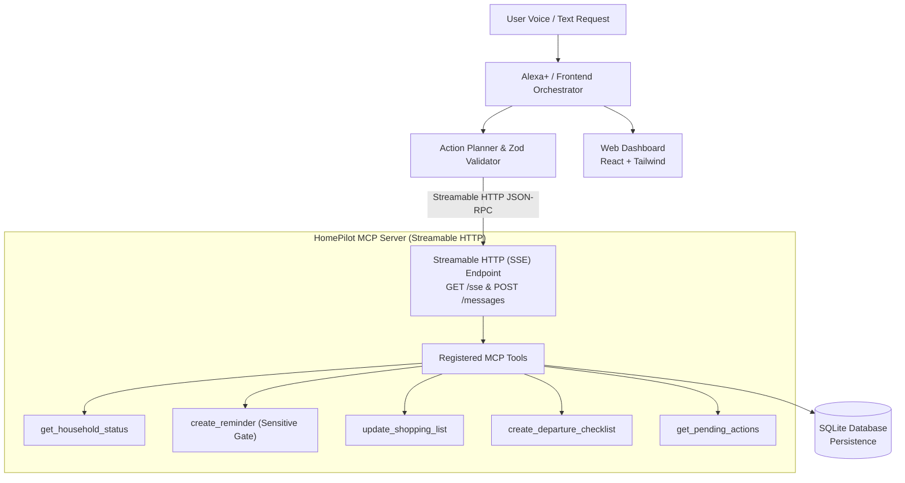

# HomePilot AI — Alexa+ Track (Amazon Developer Hackathon)

> **Action-first household agent** for Alexa+ that turns natural-language requests into verified action plans, invokes real MCP tools over Streamable HTTP, persists state in SQLite, and displays live multi-step execution.

---

## ⚠️ Important Note: What is Real vs Simulated

- **Real & Functional**:
  - **Model Context Protocol (MCP) Server**: Built with the official `@modelcontextprotocol/sdk` in TypeScript.
  - **Streamable HTTP (SSE)**: Full streaming HTTP protocol support as mandated by the Alexa+ platform requirements (`/sse` and `/messages`).
  - **State Persistence**: SQLite database preserving all reminders, departure checklists, and shopping lists across page refreshes and server restarts.
  - **Deterministic Orchestration**: Strict plan parsing, sequential tool execution, sensitive action approval gate, retry, and cancellation.
  - **Web Application**: Real-time React dashboard communicating directly with the MCP server.

- **Simulated Demo Data**:
  - IoT telemetry (plant soil moisture sensor readings, smart lock status, grocery inventory weights) is clearly tagged with `"simulated": true` and labeled as **"Simulated demo data"** in the tool response and UI badges. No physical hardware control is claimed without active integrations.

---

## Architecture Overview



---

## Phase 1 Deliverables

1. **Monorepo Structure**:
   - `shared/` — TypeScript contracts, types (`types.ts`), and Zod validation schemas (`schemas.ts`).
   - `server/` — Model Context Protocol server exposing tools via Streamable HTTP (SSE) and direct REST.
   - `web/` — React frontend dashboard (scaffolded in Phase 4).

2. **Core Tool Implemented**:
   - `get_household_status`: Returns structured JSON containing plant telemetry, grocery staple levels, pending chores, safety alerts, ISO timestamps, and action IDs.

3. **Streamable HTTP Verified**:
   - Standard MCP SSE endpoint at `http://localhost:3001/sse`.
   - Message routing at `http://localhost:3001/messages`.
   - Health and tool schema discovery at `http://localhost:3001/health` and `http://localhost:3001/api/tools`.

---

## Quickstart & Verification Commands

### 1. Install Dependencies
```bash
npm install
```

### 2. Run the MCP Server
```bash
npm run dev:server
```
The server will start on `http://localhost:3001`.

### 3. Verify Server Endpoints

#### Health Check
```bash
curl http://localhost:3001/health
```

#### Direct Tool Invocation (REST)
```bash
curl -X POST http://localhost:3001/api/tools/get_household_status
```

#### Run Automated Vitest Suite (Unit & Streamable HTTP Integration)
```bash
npm test
```

---

## Adding HomePilot AI to Antigravity's MCP Configuration

To register the HomePilot AI server with Antigravity IDE:

1. Open your Antigravity MCP configuration file at:
   `C:\Users\rajen\.gemini\config\mcp_config.json` (or workspace `.agents/mcp_config.json`).
2. Add the `homepilot` server definition under `mcpServers`:

```json
{
  "mcpServers": {
    "homepilot": {
      "url": "http://localhost:3001/sse"
    }
  }
}
```

Antigravity will automatically connect to `http://localhost:3001/sse`, discover `get_household_status`, and expose it for agentic invocation.
